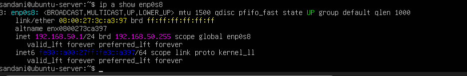
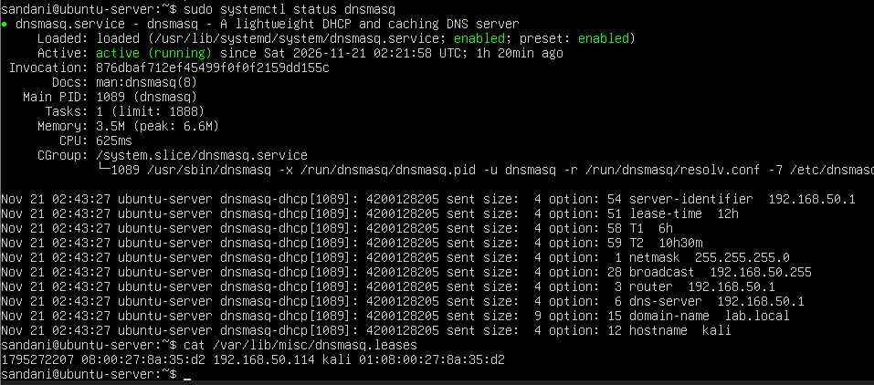
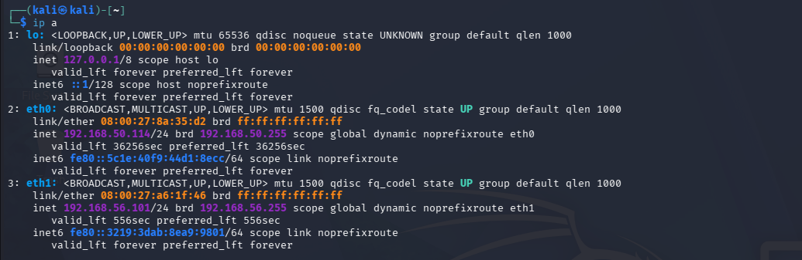
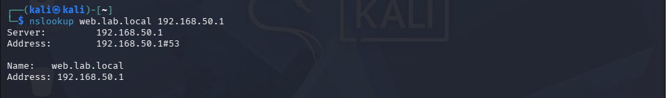
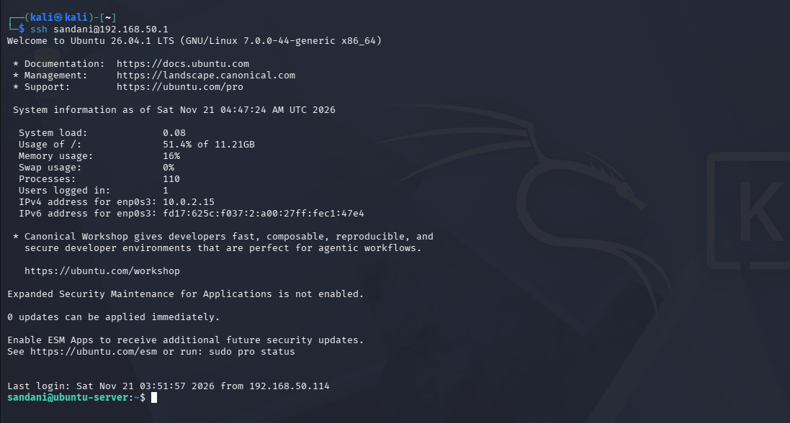
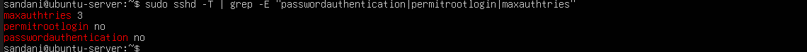
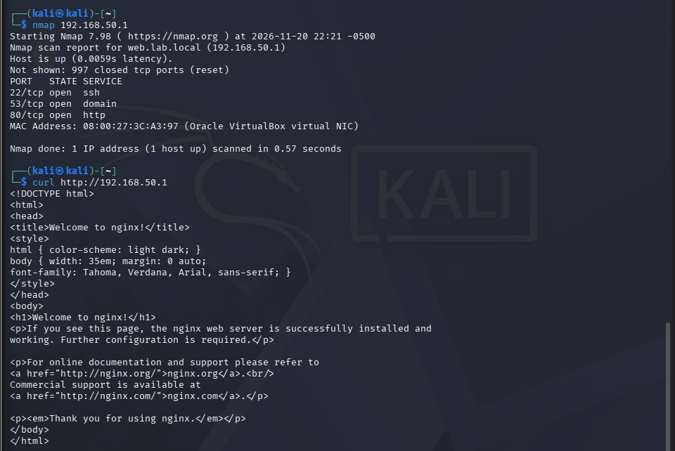
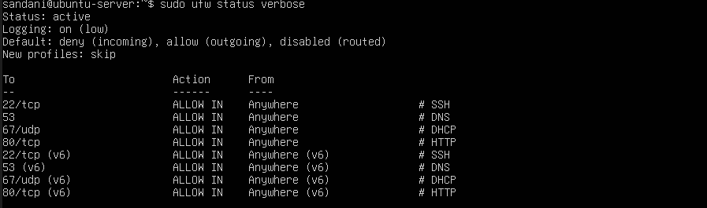
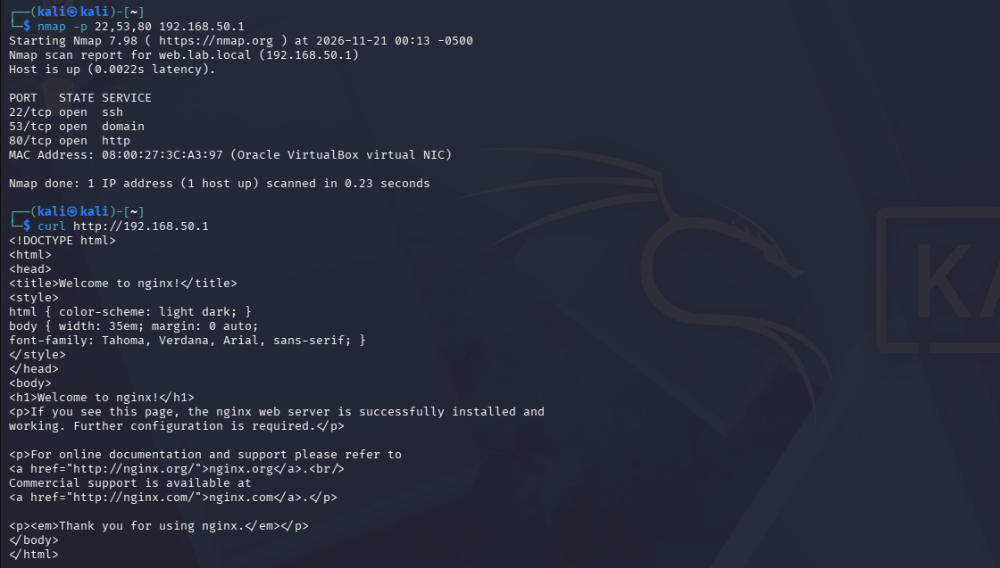

# Linux Server Lab (Ubuntu Server, VirtualBox)

A small isolated lab network built in VirtualBox. An **Ubuntu Server** provides network services and is hardened, and a **Kali Linux** VM acts as the client and tester. Security was verified with `nmap` scans before and after the firewall.

> All scanning was done only against my own lab VMs.

## Lab Overview

```
[Kali VM  client]---- Internal network "labnet" ----[Ubuntu Server]---- NAT ---- Internet
   gets IP by DHCP        192.168.50.0/24               192.168.50.1             (for apt updates)
```

| Service | Tool | Purpose |
|---|---|---|
| Static IP | Netplan | Fixed lab address for the server |
| DHCP + DNS | dnsmasq | Address pool and local name `web.lab.local` |
| SSH | OpenSSH | Remote login, hardened with keys |
| Firewall | UFW (iptables) | Default deny, only needed ports open |
| Web server | nginx | Test service used to demonstrate the firewall |

**Addressing plan**

| Item | Value |
|---|---|
| Lab network | 192.168.50.0/24 |
| Server | 192.168.50.1 |
| DHCP pool | 192.168.50.100 to 192.168.50.150 |
| DNS name | web.lab.local -> 192.168.50.1 |

## Environment

- Host: VirtualBox
- Server VM: Ubuntu Server 26.04 LTS (2 GB RAM, 2 CPUs, 20 GB disk)
- Client VM: Kali Linux
- Adapters: Ubuntu has NAT (internet) and Internal Network `labnet`; Kali has Internal Network `labnet`

## 1. Static IP with Netplan

The lab-side interface `enp0s8` was given a fixed address.

Config: [`configs/60-lab.yaml`](configs/60-lab.yaml)



## 2. DHCP and DNS with dnsmasq

dnsmasq hands out addresses in 192.168.50.100-150 and resolves `web.lab.local`.

Config: [`configs/lab.conf`](configs/lab.conf)



Kali received an address by DHCP:



DNS lookup of the local name:



The lease on the server:


## 3. SSH with key authentication

An ed25519 key pair was created on Kali and installed on the server. Password login and root login were then disabled.

Config: [`configs/01-hardening.conf`](configs/01-hardening.conf)

```
PasswordAuthentication no
PermitRootLogin no
MaxAuthTries 3
```

Key login works without a password:



Forcing password login is refused:


Effective server settings:



## 4. Firewall with UFW

nginx was installed as a test service, then scanned from Kali **before** and **after** enabling the firewall.

**Before the firewall:** ports 22, 53 and 80 are open.



**Rules applied** (default deny incoming, allow outgoing; SSH, DNS and DHCP allowed):

```
sudo ufw default deny incoming
sudo ufw default allow outgoing
sudo ufw allow 22/tcp comment 'SSH'
sudo ufw allow 53 comment 'DNS'
sudo ufw allow 67/udp comment 'DHCP'
sudo ufw enable
```

Status: [`configs/ufw-status.txt`](configs/ufw-status.txt)



**After the firewall:** port 80 is filtered and `curl` times out, while SSH and DNS keep working.


**After `sudo ufw allow 80/tcp`:** the web service is reachable again.



## Results

| Check | Before firewall | After firewall | After allowing 80 |
|---|---|---|---|
| Port 22 (SSH) | open | open | open |
| Port 53 (DNS) | open | open | open |
| Port 80 (HTTP) | open | filtered (curl timeout) | open |

## Problems and Fixes

- `apt upgrade` failed with a permission error because `sudo` was missing on the second command. Fixed by running `sudo apt upgrade -y`.
- SSH showed `inactive (dead)` after installing. Fixed with `sudo systemctl enable --now ssh`.
- Nmap did not list port 80 after the firewall. It groups blocked ports as filtered, so `nmap -p 22,53,80` was used to show it explicitly.

## What I Learned

- DHCP assigns addresses, DNS resolves names, and each can be verified separately.
- Key-based SSH is safer than passwords, and `Permission denied (publickey)` proves passwords are off.
- A default-deny firewall must allow SSH before it is enabled, or you lock yourself out.
- Before-and-after scans give clear evidence that a firewall works.

## Repository Layout

```
linux-server-lab/
├── README.md
├── configs/
│   ├── 60-lab.yaml
│   ├── lab.conf
│   ├── 01-hardening.conf
│   └── ufw-status.txt
└── screenshots/
```

## Technology Stack

Ubuntu Server, Kali Linux, VirtualBox, Netplan, dnsmasq, OpenSSH, UFW/iptables, nginx
